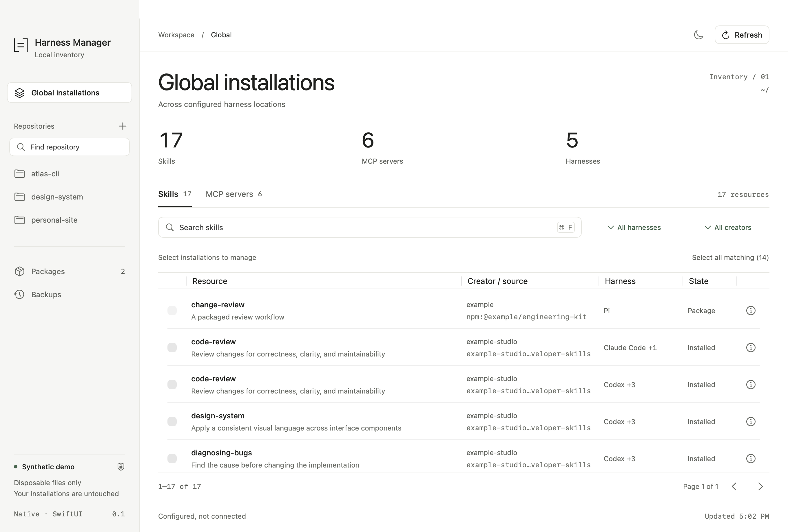

# Harness Manager

A native macOS app for inspecting **skills, MCP configuration, and Pi packages across agent harnesses**.

Swift and SwiftUI throughout. No browser, WebView, local web server, or Node.js runtime.



## Download and install

**[Download the universal macOS DMG](https://github.com/larrysammii/simple-harness-management/releases/download/v0.1.0/Harness-Manager-0.1.0-universal.dmg)** · [Release notes and checksum](https://github.com/larrysammii/simple-harness-management/releases/tag/v0.1.0)

Requires **macOS 14.4+**. Runs on **Apple Silicon and Intel**. No development tools are needed.

1. Open the DMG
2. Drag **Harness Manager** to **Applications**
3. Open the app from Applications, then eject the DMG

**First-launch notice:** this release is ad-hoc signed, **not Apple Developer ID-signed or notarized**. If macOS blocks it, only proceed if you trust this repository: attempt to open the app, then use **System Settings → Privacy & Security → Open Anyway** if offered. See [Apple's instructions](https://support.apple.com/en-us/102445). Do not disable Gatekeeper globally.

## Build from source

Requires **macOS 14.4+** and a **Swift 6 toolchain**. Apple's Command Line Tools are sufficient to build the app; Xcode is optional.

```sh
xcode-select --install  # only if developer tools are not installed
bash scripts/build-app.sh
open "build/Harness Manager.app"
```

The first build downloads the pinned, native TOML and YAML parser dependencies. Running the app does not require a network connection.

The build script produces a locally ad-hoc-signed `.app`, not a notarized distribution. By default it builds for the current Mac's architecture. For a universal app and drag-to-Applications installer:

```sh
bash scripts/build-dmg.sh
```

This creates `build/Harness-Manager-0.1.0-universal.dmg` and `build/SHA256SUMS.txt`. The universal app is also available at `build/universal/Harness Manager.app`. Release binaries are stripped of private build paths; any required native Swift compatibility libraries and complete third-party notices are bundled.

For development:

```sh
bash scripts/build-app.sh debug
open "build/Harness Manager.app"
```

## Try without reading your installations

```sh
open -n "build/Harness Manager.app" --args --demo
```

Demo mode creates real, disposable files inside a synthetic temporary home. The UI labels it **Synthetic demo**. It never falls back to your real home if fixture creation fails.

## Use

1. Choose **Global installations** or a repository. Add a folder with **⌘N**.
2. Choose **Skills** or **MCP servers**. Search with **⌘F**, or filter by harness and creator.
3. Open **Details** to inspect a path, provenance, or protection reason. **Reveal** opens Finder.
4. Select removable rows and choose **Uninstall selected**. Review every path and type the confirmation.
5. Open **Backups → Restore** to recover a completed change. Reload the affected harness afterward.

**⌘R** refreshes inventory. **⌘1–4** switch between Skills, MCP servers, Packages, and Backups. Light is the default; use the appearance button or **Settings** for dark/system appearance.

### Scope and selection

Global installations inherited by a repository are labelled **(globally installed)** and cannot be removed from that repository view. A repository link pointing at a global skill is inherited too. An independent local copy remains local and is identified as an override.

Equivalent registrations of the same source appear as one row with a harness count. Distinct symbolic links remain separate installations. Removing a link never removes its target.

Select-all includes removable matches across pagination, up to 1,000 installations. Pagination preserves selection. Changing search, filters, scope, section, resource kind, or refreshed inventory clears selection. Row focus and destructive checkbox selection are separate states.

### Packages

**Packages** manages configured Pi bundle registrations, not cached files. Review the package name, scope, settings path, and installed/enabled resources before confirming.

Equivalent versioned/unversioned declarations in one scope are removed together. Downloaded skills, extensions, prompts, themes, dependencies, and generated data stay on disk. Other settings and scopes stay intact. Explicit direct resource references block an incomplete unregister operation. No Pi, npm, package code, lifecycle script, or extension is executed.

Counts describe manifests, cached files, and resource filters—not live execution. Missing or incomplete caches are identified. Restoring a registration does not restore a missing download.

## Discovery coverage

Adapters are explicit in [`Registry.swift`](Sources/HarnessCore/Registry.swift). Coverage means standard file-based configuration, not runtime approval, enterprise policy, or every plugin marketplace.

| Harness | Skills | MCP configuration |
| --- | --- | --- |
| Shared resources | `.agents/skills` | Shared MCP JSON files |
| Claude Code | Global and repository `.claude/skills` | User, project, and local-scope JSON |
| Codex | Shared, legacy, and protected system/package skills | `mcp_servers` TOML tables |
| Pi | Global/repository skills, explicit paths, configured package resources | Native JSON, adapter JSON, known compatibility imports |
| Cursor | Native and compatible shared roots | Global/repository MCP JSON |
| OpenCode | Native and compatible roots | JSON/JSONC `mcp` maps |
| Gemini CLI / Amp | Native/shared roots | Settings-based MCP maps |
| Windsurf | Global/repository roots | Global MCP JSON |
| Roo Code / Cline | Native roots and editor-managed locations | Editor/global/repository MCP JSON |
| Continue | Global/repository roots | YAML/JSON, including `mcpServers/*.yaml` |
| Copilot / VS Code | Global and `.github/skills` | VS Code MCP JSON `servers` maps |

Pi resource include/exclude filters are reflected in enabled state and inheritance. Package-owned skills, generated memory, system skills, imported MCP references, symbolic-link configs, and override-only definitions remain protected.

JSON/JSONC, named TOML tables, and ordinary block YAML entries support verified source-preserving removal. Inline TOML server maps, flow YAML, aliases, and other layouts that cannot be safely edited stay read-only. Invalid, oversized, or unsupported sources produce a notice instead of an editable row.

## Safety and privacy

- Discovery reads files only. It does not connect to MCP servers, start agents, fetch provenance, or upload inventory. Public source links open in your browser only when clicked.
- Commands, arguments, environment values, and server URLs are not included in inventory metadata. Creator/source metadata is recorded provenance, not proof of original authorship. Unrecorded creators stay **Unknown**.
- Every selection is re-scanned and checked for scope, protection, fingerprints, and overlapping paths before deletion. Config entries in the same file are edited together and semantically verified.
- Changes create private, recoverable backups first. A batch stops on failure and reports partial completion; completed changes are not silently rolled back or retried.
- Restore refuses occupied skill destinations, redirected parents, symlinked configs, modified payloads, and configuration edits made after removal. An actor and an interprocess lock serialize app mutations.

App data lives in `~/Library/Application Support/Harness Manager`. Storage directories use mode `0700` without inherited ACL grants; backup configuration payloads use `0600`. Replacing a configuration preserves its existing ACLs, extended attributes, owner/group, and permissions. Restore does not undo permissions you tightened afterward. **Backups can contain credentials from original configurations.** Keep this directory private; do not commit or upload it. OAuth tokens are not revoked by removing a configuration entry.

Repository discovery checks `~/repo`, `~/repos`, `~/Projects`, and `~/Developer`, with depth and item limits. Add any other folder explicitly. Standard harness environment overrides are honored when available to the app process; Finder-launched apps do not inherit every shell variable. macOS permission failures appear as scan notices. The app is intentionally not sandboxed, so it can manage user-selected configuration paths.

## Tests

```sh
bash scripts/test.sh
swift run harness-manager-check --exercise
```

With Xcode selected, the script runs **XCTest**. On a Command-Line-Tools-only Mac, it compiles and executes the **same test methods** with a small native assertion adapter; it does not claim to run Apple's unavailable XCTest framework. Generated runner sources stay in a disposable temporary directory. Core and SwiftUI state tests use synthetic homes only.

The diagnostics command exercises native discovery, single and grouped removal, all three configuration formats, byte-exact restore, and package unregister. `--live` is read-only and prints counts only; it cannot be combined with `--exercise`.

CI uses Xcode/XCTest on macOS, builds and verifies both native architectures, and uploads a universal DMG artifact. Published installers are available from GitHub Releases.

## License

[MIT](LICENSE)
